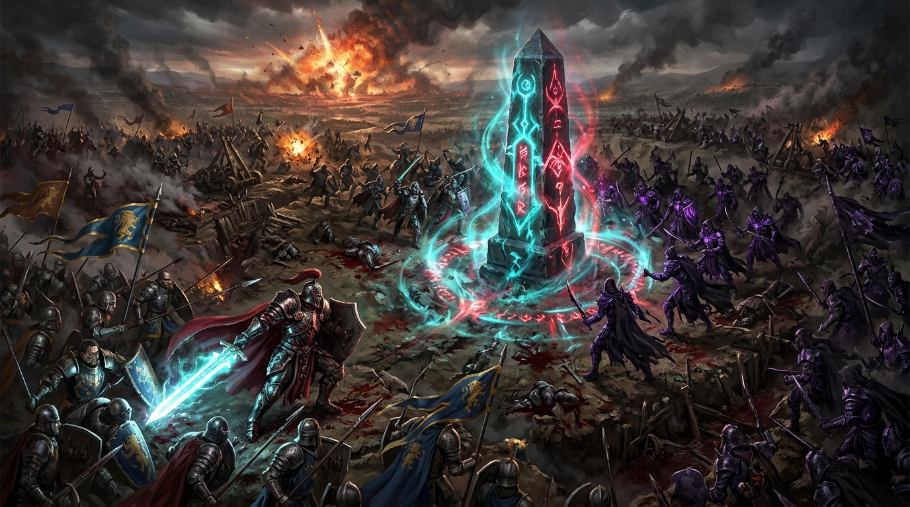

# ⚔️ DOMINATOR: Conquista dos Reinos RPG

**DOMINATOR** é um jogo RPG tático de ação e dominação territorial em tempo real, desenvolvido em HTML5 Canvas e JavaScript puro, sem dependências externas. Comande seu Herói, conquiste territórios protegidos por torres arcanas, invoque esquadrões de soldados e domine campos de batalha massivos.

---

## 🌟 Principais Recursos

### 🗺️ 3 Campos de Batalha Massivos (4800 x 3200)
- 🌲 **Vale da Aurora:** Vales verdejantes, rios caudalosos com pontes de madeira e pedra, florestas de carvalhos e ruínas ancestrais.
- ❄️ **Picos da Geada:** Tundra glacial, rios congelados, pinheiros cobertos de neve, névoa e cristais de gelo.
- 🌋 **Forja Vulcânica:** Rios de lava ardente com fumaça e fuligem, rochas de obsidiana, brasas flutuantes e altares de fogo.

### ⚔️ Combate Visceral & Combos RPG
- **Combo de 3 Golpes:**
  - *Golpe 1:* Corte rápido da direita com rastro de energia ciano.
  - *Golpe 2:* Corte de retorno com velocidade e 1.3x de dano.
  - *Golpe 3 (Finalizador):* Golpe pesado devastador com **2.2x de dano**, crítico garantido e explosão dourada de faíscas.
- **Arcos de Espada Radiantes:** Efeitos visuais luminosos desenhados a cada golpe.
- **Hit-Flash & Recuo Físico:** Inimigos atingidos piscam em branco e sofrem repulsão física instantânea.

### 🔮 Poderes e Magias
- **[Q] Lâmina Giratória:** Turbilhão de cortes em 360° com alto dano em área e repulsão.
- **[E] Chuva de Meteoros:** Invoca um colossal meteoro do céu com rastro de fumaça, indicador rúnico de área no chão e tremor de tela.
- **[R] Grito de Guerra:** Trombeta de guerra que concede +50% de dano e escudo radiante para você e todas as tropas aliadas próximas.
- **[ESPAÇO] Investida Fantasma:** Esquiva veloz com linhas de velocidade e rastro sombrio.
- **[F] Convocar Guarda Real:** Invoca imediatamente 3 guardas de elite (Guerreiro, Arqueira e Mago) para marchar ao seu lado.

### 📱 Compatibilidade Total com Celular (Mobile Ready)
- **Joystick Virtual Analógico:** Toque e deslize o polegar esquerdo para correr livremente em 360°.
- **Botão de Ataque com Auto-Aim:** Ao tocar no botão de ataque no celular, o herói mira e desfere combos automaticamente no inimigo mais próximo.
- **Satélites de Habilidades Touch:** Disposição ergonômica em arco ao redor do polegar direito com recarga animada.
- **Modo Tela Cheia & Radar Recolhível:** Projetado para a melhor experiência em smartphones e tablets.

### 🛡️ Dominação de Territórios & Postos Estratégicos
- Cada base capturada eleva o estandarte da sua facção.
- **Torres de Defesa Cristalinas:** Uma vez conquistado, o obelisco central dispara feixes de energia contra invasores.
- **Geração de Tropas:** Bases conquistadas enviam levas de soldados pelas estradas em direção aos postos inimigos a cada 9 segundos.
- **Meta de 1000 Pontos:** A primeira facção a alcançar a pontuação máxima vence a guerra.

### 🔊 Trilha Sonora & Efeitos Sonoros Procedurais
- Motor de áudio construído 100% sobre a Web Audio API (sem arquivos de áudio externos pesados).
- Sons de espadas, flechas balísticas, conjuração de magias, impactos de meteoro, toques de trombeta de conquista e tambores de guerra medievais.

---

## 🎮 Controles

### No Computador (PC)
| Tecla / Comando | Ação |
| :--- | :--- |
| **W, A, S, D** ou **Setas** | Mover Lord Dominator |
| **Botão Direito do Mouse** | Mover para o ponto clicado no chão ou no minimapa |
| **Botão Esquerdo do Mouse** | Desferir combo de golpes de espada na mira |
| **Roda do Mouse (Scroll)** | Zoom in / Zoom out da câmera (0.75x a 1.25x) |
| **Q** | Lâmina Giratória (Dano em Área) |
| **E** | Chuva de Meteoros (No local do cursor) |
| **R** | Grito de Guerra (Aura de Dano e Escudo) |
| **ESPAÇO** | Investida Fantasma (Esquiva) |
| **F** | Convocar Guarda Real (3 unidades) |
| **B** ou **Esc** | Abrir/Fechar Loja de Melhorias |

### No Celular / Dispositivos Touch
| Controle | Ação |
| :--- | :--- |
| **Analógico na Esquerda** | Mover o herói em 360° |
| **Botão ⚔️ na Direita** | Combo de espada com **Auto-Aim inteligente** no alvo mais próximo |
| **Botões de Poder (Q, E, R, DASH, F)** | Disparo ágil de habilidades com o polegar direito |
| **Botão 🗺️ Radar** | Alternar / Recolher Minimapa |
| **Botão ⛶** | Alternar Tela Cheia |

---

## 🛠️ Tecnologias Utilizadas
- **HTML5 Canvas:** Renderização a 60 FPS com ordenação de profundidade (Y-sort).
- **Vanilla JavaScript (ES6+):** Zero bibliotecas externas ou frameworks pesados.
- **CSS3 Moderno:** Glassmorphism, tipografia via Google Fonts (*Cinzel* e *Rajdhani*).
- **Web Audio API:** Síntese de áudio procedural e ambiência orquestral/percussiva em tempo real.

---

## 🚀 Como Executar Localmente

### Opção 1: Direto no Navegador (PC)
Basta dar um duplo-clique no arquivo `index.html` em qualquer navegador moderno (Chrome, Edge, Firefox, Safari).

### Opção 2: Jogar no Celular (Mesmo Wi-Fi)
1. Execute o arquivo `iniciar_servidor_celular.bat` (ou execute `python -m http.server 8080`).
2. No celular, acerte o endereço exibido no terminal (ex: `http://192.168.1.8:8080`).
3. Deite o celular na horizontal e divirta-se!

---

Desenvolvido com dedicação para a melhor experiência RPG de dominação em navegador. ⚔️👑
